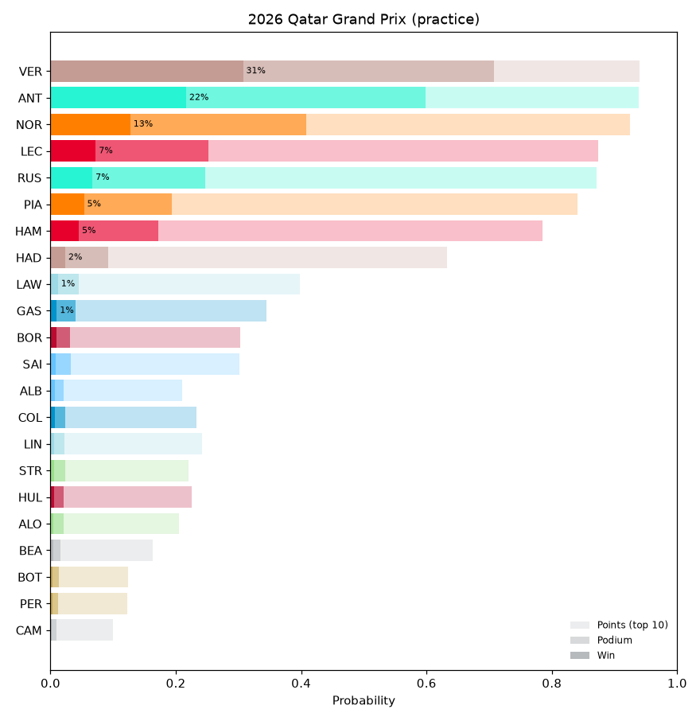

# 2026 Qatar Grand Prix — practice

Made 2026-11-28T04:21:19+00:00 (git e32fdbc, config eb5a1ab020e8, pitwall-f1 2.1.0.dev14). Race date 2026-11-29.

| # | Driver | Team | Win | Podium | Points | DNF | Exp. pos |
|---|---|---|---|---|---|---|---|
| 1 | VER | red-bull | 30.7% | 70.7% | 94.0% | 5.8% | 3.5 |
| 2 | ANT | mercedes | 21.6% | 59.9% | 93.9% | 5.9% | 4.1 |
| 3 | NOR | mclaren | 12.7% | 40.8% | 92.5% | 6.8% | 5.2 |
| 4 | LEC | ferrari | 7.2% | 25.2% | 87.4% | 7.7% | 6.6 |
| 5 | RUS | mercedes | 6.7% | 24.7% | 87.2% | 8.0% | 6.6 |
| 6 | PIA | mclaren | 5.3% | 19.4% | 84.1% | 7.6% | 7.2 |
| 7 | HAM | ferrari | 4.5% | 17.2% | 78.5% | 11.7% | 8.0 |
| 8 | HAD | red-bull | 2.4% | 9.2% | 63.2% | 11.0% | 9.6 |
| 9 | LAW | racing-bulls | 1.2% | 4.5% | 39.8% | 11.5% | 11.9 |
| 10 | GAS | alpine | 1.0% | 4.0% | 34.5% | 15.0% | 12.6 |
| 11 | SAI | williams | 0.8% | 3.2% | 30.2% | 17.5% | 13.3 |
| 12 | BOR | audi | 0.9% | 3.1% | 30.3% | 17.9% | 13.3 |
| 13 | LIN | racing-bulls | 0.6% | 2.3% | 24.1% | 14.2% | 13.9 |
| 14 | COL | alpine | 0.6% | 2.3% | 23.3% | 16.7% | 14.1 |
| 15 | HUL | audi | 0.6% | 2.1% | 22.5% | 18.0% | 14.3 |
| 16 | ALB | williams | 0.6% | 2.1% | 21.0% | 16.3% | 14.4 |
| 17 | STR | aston-martin | 0.6% | 2.4% | 22.0% | 35.5% | 15.0 |
| 18 | BEA | haas | 0.4% | 1.6% | 16.4% | 18.3% | 15.2 |
| 19 | ALO | aston-martin | 0.5% | 2.1% | 20.5% | 37.8% | 15.3 |
| 20 | BOT | cadillac | 0.3% | 1.3% | 12.3% | 20.0% | 16.1 |
| 21 | PER | cadillac | 0.3% | 1.2% | 12.3% | 22.8% | 16.2 |
| 22 | CAM | haas | 0.2% | 1.0% | 10.0% | 21.7% | 16.7 |

Data availability: has_openf1=1, has_practice_pace=1, has_forecast=1, has_track_temp=1, has_qualifying=0, topped_up_races=0

[All predictions](../index.md)
