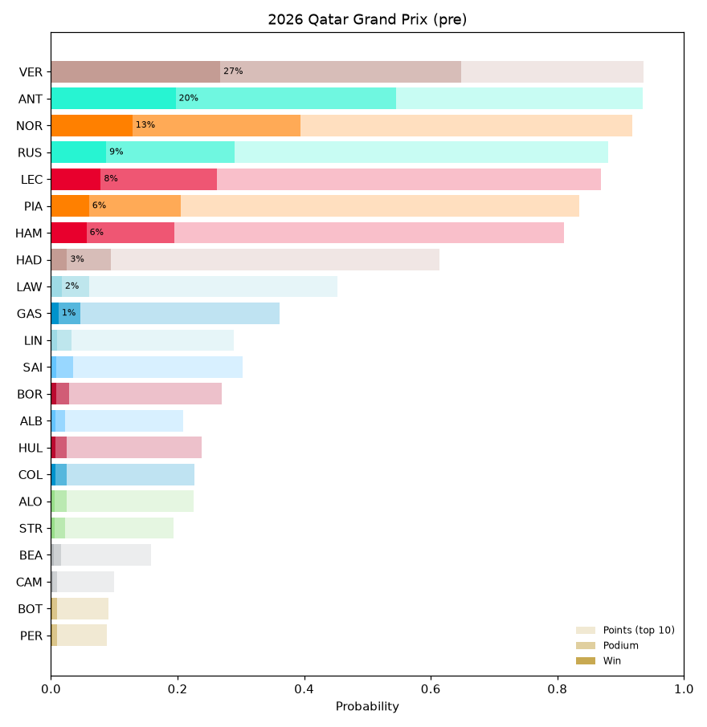

# 2026 Qatar Grand Prix — pre

Made 2026-11-25T01:40:29+00:00 (git 1460070, config d2f34c5f9e35, pitwall-f1 2.0.0rc2). Race date 2026-11-29.

| # | Driver | Team | Win | Podium | Points | DNF | Exp. pos |
|---|---|---|---|---|---|---|---|
| 1 | VER | red-bull | 26.7% | 64.7% | 93.6% | 6.2% | 3.9 |
| 2 | ANT | mercedes | 19.7% | 54.5% | 93.5% | 6.0% | 4.4 |
| 3 | NOR | mclaren | 12.9% | 39.4% | 91.9% | 6.9% | 5.3 |
| 4 | RUS | mercedes | 8.7% | 29.0% | 88.0% | 8.0% | 6.3 |
| 5 | LEC | ferrari | 7.9% | 26.2% | 86.9% | 7.8% | 6.6 |
| 6 | PIA | mclaren | 6.0% | 20.5% | 83.5% | 7.7% | 7.2 |
| 7 | HAM | ferrari | 5.6% | 19.5% | 81.0% | 9.4% | 7.6 |
| 8 | HAD | red-bull | 2.5% | 9.5% | 61.3% | 11.4% | 9.8 |
| 9 | LAW | racing-bulls | 1.7% | 6.0% | 45.3% | 11.8% | 11.3 |
| 10 | GAS | alpine | 1.2% | 4.6% | 36.1% | 15.5% | 12.4 |
| 11 | LIN | racing-bulls | 0.9% | 3.2% | 28.9% | 14.5% | 13.2 |
| 12 | SAI | williams | 0.9% | 3.4% | 30.3% | 18.0% | 13.2 |
| 13 | BOR | audi | 0.9% | 2.9% | 26.9% | 16.4% | 13.6 |
| 14 | HUL | audi | 0.7% | 2.5% | 23.8% | 18.0% | 14.0 |
| 15 | COL | alpine | 0.6% | 2.5% | 22.7% | 16.5% | 14.1 |
| 16 | ALB | williams | 0.7% | 2.3% | 20.8% | 17.0% | 14.4 |
| 17 | ALO | aston-martin | 0.6% | 2.5% | 22.5% | 31.9% | 14.8 |
| 18 | STR | aston-martin | 0.5% | 2.2% | 19.3% | 31.0% | 15.2 |
| 19 | BEA | haas | 0.4% | 1.6% | 15.8% | 18.9% | 15.3 |
| 20 | CAM | haas | 0.3% | 1.0% | 10.0% | 22.2% | 16.6 |
| 21 | BOT | cadillac | 0.2% | 1.0% | 9.1% | 20.8% | 16.8 |
| 22 | PER | cadillac | 0.2% | 0.9% | 8.8% | 24.0% | 17.0 |

Data availability: has_openf1=0, has_practice_pace=0, has_forecast=1, has_track_temp=0, has_qualifying=0, topped_up_races=0

- ⚠ Entry list = the last race's starters (no session of this meeting has finished yet).

[All predictions](../index.md)
