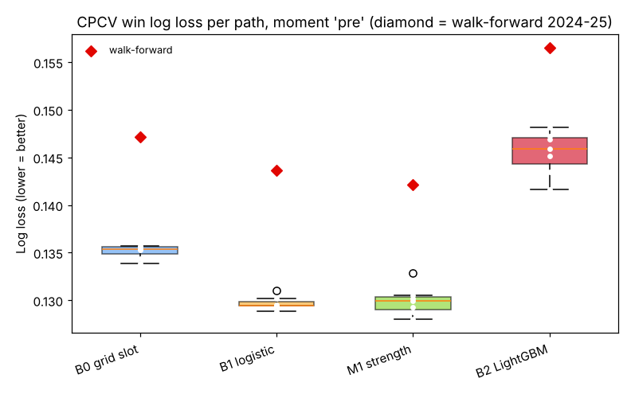
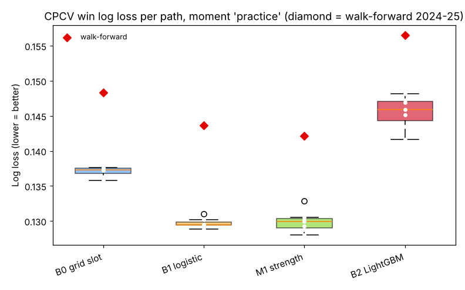
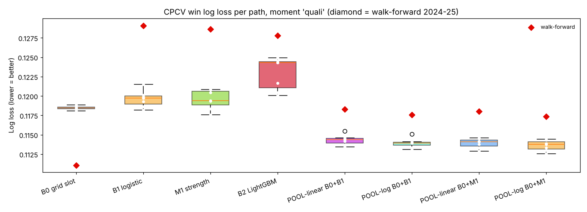
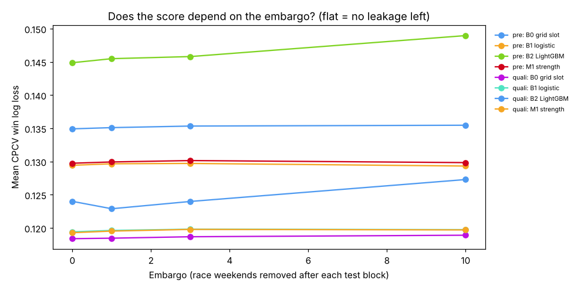

# pitwall validation (Phase 15)

> Run in the Phase 15 sandbox on an f1db-only dataset (OpenF1 practice/safety-car data and Open-Meteo forecasts were not reachable there, so practice and weather features are missing; B0 after qualifying uses only the grid and matches the Phase 14 numbers exactly: win LL 0.1111). Practice was run at embargo 1 only. The weekly train workflow regenerates this report on the full dataset.

Generated 2026-11-26 (git unknown). Data fingerprint(s): 068b0bc501f2, 40e791bea0de, 5ea64a7fcd96. 2026 is never used.

- **Walk-forward** (primary, time-honest): every race of 2024-2025 predicted by models trained only on earlier races. The gate season is 2025.
- **CPCV** (robustness check): races 2018-2025 in 8 time blocks, every pair of blocks as test (28 splits), 1-race embargo after each test block, assembled into 7 full backtest paths. Log loss = binary log loss over driver rows.
- Lower log loss is better. P5 / P95 are interpolated from the 7 path scores.

## Moment: pre

| Model | WF win LL 2024-25 | WF win LL 2025 | CPCV win mean | win P5 | win median | win P95 | CPCV podium mean | podium P5 | podium median | podium P95 |
|---|---|---|---|---|---|---|---|---|---|---|
| B0 grid slot | 0.1472 | 0.1394 | 0.1351 | 0.1340 | 0.1354 | 0.1357 | 0.2909 | 0.2902 | 0.2908 | 0.2917 |
| B1 logistic | 0.1437 | 0.1415 | 0.1297 | 0.1290 | 0.1294 | 0.1307 | 0.2716 | 0.2699 | 0.2720 | 0.2730 |
| M1 strength | 0.1422 | 0.1400 | 0.1299 | 0.1282 | 0.1299 | 0.1322 | 0.2745 | 0.2707 | 0.2741 | 0.2796 |
| B2 LightGBM | 0.1565 | 0.1542 | 0.1455 | 0.1422 | 0.1459 | 0.1479 | 0.3038 | 0.2990 | 0.3027 | 0.3099 |

## Moment: practice

| Model | WF win LL 2024-25 | WF win LL 2025 | CPCV win mean | win P5 | win median | win P95 | CPCV podium mean | podium P5 | podium median | podium P95 |
|---|---|---|---|---|---|---|---|---|---|---|
| B0 grid slot | 0.1483 | 0.1407 | 0.1370 | 0.1360 | 0.1373 | 0.1376 | 0.2927 | 0.2921 | 0.2927 | 0.2934 |
| B1 logistic | 0.1437 | 0.1415 | 0.1297 | 0.1290 | 0.1294 | 0.1307 | 0.2716 | 0.2699 | 0.2720 | 0.2730 |
| M1 strength | 0.1422 | 0.1400 | 0.1299 | 0.1282 | 0.1299 | 0.1322 | 0.2745 | 0.2707 | 0.2741 | 0.2796 |
| B2 LightGBM | 0.1565 | 0.1542 | 0.1455 | 0.1422 | 0.1459 | 0.1479 | 0.3038 | 0.2990 | 0.3027 | 0.3099 |

## Moment: quali

| Model | WF win LL 2024-25 | WF win LL 2025 | CPCV win mean | win P5 | win median | win P95 | CPCV podium mean | podium P5 | podium median | podium P95 |
|---|---|---|---|---|---|---|---|---|---|---|
| B0 grid slot | 0.1111 | 0.0960 | 0.1185 | 0.1181 | 0.1185 | 0.1188 | 0.2381 | 0.2375 | 0.2382 | 0.2387 |
| B1 logistic | 0.1291 | 0.1234 | 0.1196 | 0.1183 | 0.1198 | 0.1211 | 0.2383 | 0.2361 | 0.2386 | 0.2401 |
| M1 strength | 0.1286 | 0.1230 | 0.1195 | 0.1178 | 0.1194 | 0.1208 | 0.2394 | 0.2360 | 0.2396 | 0.2421 |
| B2 LightGBM | 0.1278 | 0.1159 | 0.1229 | 0.1202 | 0.1243 | 0.1248 | 0.2606 | 0.2568 | 0.2605 | 0.2644 |
| POOL-linear B0+B1 | 0.1183 | 0.1063 | 0.1143 | 0.1135 | 0.1144 | 0.1152 | 0.2310 | 0.2297 | 0.2311 | 0.2319 |
| POOL-log B0+B1 | 0.1176 | 0.1057 | 0.1139 | 0.1132 | 0.1139 | 0.1148 | 0.2292 | 0.2279 | 0.2293 | 0.2300 |
| POOL-linear B0+M1 | 0.1180 | 0.1060 | 0.1139 | 0.1130 | 0.1141 | 0.1145 | 0.2311 | 0.2292 | 0.2315 | 0.2325 |
| POOL-log B0+M1 | 0.1173 | 0.1053 | 0.1136 | 0.1127 | 0.1138 | 0.1144 | 0.2294 | 0.2275 | 0.2300 | 0.2307 |

## Embargo sensitivity (CPCV mean win log loss)

| Moment | Model | embargo 0 | embargo 1 | embargo 3 | embargo 10 | max - min |
|---|---|---|---|---|---|---|
| pre | B0 grid slot | 0.1349 | 0.1351 | 0.1353 | 0.1355 | 0.0005 |
| pre | B1 logistic | 0.1294 | 0.1297 | 0.1297 | 0.1293 | 0.0004 |
| pre | B2 LightGBM | 0.1449 | 0.1455 | 0.1458 | 0.1490 | 0.0041 |
| pre | M1 strength | 0.1297 | 0.1299 | 0.1301 | 0.1298 | 0.0004 |
| quali | B0 grid slot | 0.1184 | 0.1185 | 0.1187 | 0.1189 | 0.0005 |
| quali | B1 logistic | 0.1194 | 0.1196 | 0.1198 | 0.1198 | 0.0004 |
| quali | B2 LightGBM | 0.1240 | 0.1229 | 0.1240 | 0.1273 | 0.0044 |
| quali | M1 strength | 0.1193 | 0.1195 | 0.1198 | 0.1197 | 0.0005 |

Largest move: B2 LightGBM at 'quali', 0.0044 win LL (tolerance 0.002).
With embargo 0 the score is lower (looks better) than with embargo 10 for 7 of 8 model-moments: lower-with-less-embargo is the signature of leakage.
**Recommendation:** the scores move by more than 0.002, so use a larger default embargo (10 race weekends covers the 10-race rolling windows; championship points still carry a whole season, so no finite embargo removes everything).

## Gate decisions (gate_v2, against B0 grid slot)

Required: the 95% paired-bootstrap CI of (candidate - B0) on 2025 entirely below 0 for win AND podium log loss; the deflated p < 0.05 once the family has >= 10 trials; the median CPCV path better than B0's. Diebold-Mariano and the 3-race block bootstrap are context.

| Moment | Candidate | Trials | Gate |
|---|---|---|---|
| pre | B1 logistic | 1 | fail |
| pre | M1 strength | 2 | fail |
| pre | B2 LightGBM | 1 | fail |
| practice | B1 logistic | 1 | fail |
| practice | M1 strength | 2 | fail |
| practice | B2 LightGBM | 1 | fail |
| quali | POOL-linear B0+B1 | 12 | fail |
| quali | POOL-log B0+B1 | 12 | fail |
| quali | POOL-linear B0+M1 | 12 | fail |
| quali | POOL-log B0+M1 | 12 | fail |
| quali | B1 logistic | 1 | fail |
| quali | M1 strength | 2 | fail |
| quali | B2 LightGBM | 1 | fail |

### Gate: B1 logistic vs B0 grid slot (pre)

| Check | Role | Result | Detail |
|---|---|---|---|
| win LL: 95% CI on 2025 entirely below 0 | required | fail | +0.0022 [-0.0088, +0.0133] over 24 races |
| podium LL: 95% CI on 2025 entirely below 0 | required | fail | +0.0039 [-0.0094, +0.0164] over 24 races |
| win LL: deflated p < 0.05 | context | fail | per-race score -0.076 over 24 races; the best of 1 useless tries would reach about +0.000 by luck; deflated p = 0.642 (required once >= 10 trials; now 1) |
| win LL: CPCV median path better | required | pass | median 0.1294 vs 0.1354; better on 7 of 7 paths |
| win LL: Diebold-Mariano (HLN) | context | fail | statistic +0.37, one-sided p = 0.643 (two-sided 0.713), 24 races |
| win LL: block bootstrap (3 races) | context | fail | +0.0022 [-0.0076, +0.0119] |

**Decision:** B1 logistic does NOT pass the gate against B0 grid slot at 'pre' (failed: win LL: 95% CI on 2025 entirely below 0; podium LL: 95% CI on 2025 entirely below 0). Keep the incumbent; move the candidate to lab/.

### Gate: M1 strength vs B0 grid slot (pre)

| Check | Role | Result | Detail |
|---|---|---|---|
| win LL: 95% CI on 2025 entirely below 0 | required | fail | +0.0007 [-0.0122, +0.0139] over 24 races |
| podium LL: 95% CI on 2025 entirely below 0 | required | fail | +0.0033 [-0.0140, +0.0191] over 24 races |
| win LL: deflated p < 0.05 | context | fail | per-race score -0.019 over 24 races; the best of 2 useless tries would reach about +0.108 by luck; deflated p = 0.731 (required once >= 10 trials; now 2) |
| win LL: CPCV median path better | required | pass | median 0.1299 vs 0.1354; better on 7 of 7 paths |
| win LL: Diebold-Mariano (HLN) | context | fail | statistic +0.09, one-sided p = 0.537 (two-sided 0.925), 24 races |
| win LL: block bootstrap (3 races) | context | fail | +0.0007 [-0.0109, +0.0116] |

**Decision:** M1 strength does NOT pass the gate against B0 grid slot at 'pre' (failed: win LL: 95% CI on 2025 entirely below 0; podium LL: 95% CI on 2025 entirely below 0). Keep the incumbent; move the candidate to lab/.

### Gate: B2 LightGBM vs B0 grid slot (pre)

| Check | Role | Result | Detail |
|---|---|---|---|
| win LL: 95% CI on 2025 entirely below 0 | required | fail | +0.0149 [+0.0015, +0.0287] over 24 races |
| podium LL: 95% CI on 2025 entirely below 0 | required | fail | +0.0381 [+0.0155, +0.0599] over 24 races |
| win LL: deflated p < 0.05 | context | fail | per-race score -0.423 over 24 races; the best of 1 useless tries would reach about +0.000 by luck; deflated p = 0.981 (required once >= 10 trials; now 1) |
| win LL: CPCV median path better | required | fail | median 0.1459 vs 0.1354; better on 0 of 7 paths |
| win LL: Diebold-Mariano (HLN) | context | fail | statistic +2.07, one-sided p = 0.975 (two-sided 0.050), 24 races |
| win LL: block bootstrap (3 races) | context | fail | +0.0149 [+0.0015, +0.0276] |

**Decision:** B2 LightGBM does NOT pass the gate against B0 grid slot at 'pre' (failed: win LL: 95% CI on 2025 entirely below 0; podium LL: 95% CI on 2025 entirely below 0; win LL: CPCV median path better). Keep the incumbent; move the candidate to lab/.

### Gate: B1 logistic vs B0 grid slot (practice)

| Check | Role | Result | Detail |
|---|---|---|---|
| win LL: 95% CI on 2025 entirely below 0 | required | fail | +0.0008 [-0.0095, +0.0112] over 24 races |
| podium LL: 95% CI on 2025 entirely below 0 | required | fail | +0.0002 [-0.0146, +0.0132] over 24 races |
| win LL: deflated p < 0.05 | context | fail | per-race score -0.029 over 24 races; the best of 1 useless tries would reach about +0.000 by luck; deflated p = 0.556 (required once >= 10 trials; now 1) |
| win LL: CPCV median path better | required | pass | median 0.1294 vs 0.1373; better on 7 of 7 paths |
| win LL: Diebold-Mariano (HLN) | context | fail | statistic +0.14, one-sided p = 0.556 (two-sided 0.888), 24 races |
| win LL: block bootstrap (3 races) | context | fail | +0.0008 [-0.0084, +0.0103] |

**Decision:** B1 logistic does NOT pass the gate against B0 grid slot at 'practice' (failed: win LL: 95% CI on 2025 entirely below 0; podium LL: 95% CI on 2025 entirely below 0). Keep the incumbent; move the candidate to lab/.

### Gate: M1 strength vs B0 grid slot (practice)

| Check | Role | Result | Detail |
|---|---|---|---|
| win LL: 95% CI on 2025 entirely below 0 | required | fail | -0.0007 [-0.0128, +0.0121] over 24 races |
| podium LL: 95% CI on 2025 entirely below 0 | required | fail | -0.0004 [-0.0176, +0.0151] over 24 races |
| win LL: deflated p < 0.05 | context | fail | per-race score +0.023 over 24 races; the best of 2 useless tries would reach about +0.108 by luck; deflated p = 0.658 (required once >= 10 trials; now 2) |
| win LL: CPCV median path better | required | pass | median 0.1299 vs 0.1373; better on 7 of 7 paths |
| win LL: Diebold-Mariano (HLN) | context | fail | statistic -0.11, one-sided p = 0.456 (two-sided 0.912), 24 races |
| win LL: block bootstrap (3 races) | context | fail | -0.0007 [-0.0110, +0.0098] |

**Decision:** M1 strength does NOT pass the gate against B0 grid slot at 'practice' (failed: win LL: 95% CI on 2025 entirely below 0; podium LL: 95% CI on 2025 entirely below 0). Keep the incumbent; move the candidate to lab/.

### Gate: B2 LightGBM vs B0 grid slot (practice)

| Check | Role | Result | Detail |
|---|---|---|---|
| win LL: 95% CI on 2025 entirely below 0 | required | fail | +0.0135 [+0.0010, +0.0266] over 24 races |
| podium LL: 95% CI on 2025 entirely below 0 | required | fail | +0.0345 [+0.0113, +0.0564] over 24 races |
| win LL: deflated p < 0.05 | context | fail | per-race score -0.410 over 24 races; the best of 1 useless tries would reach about +0.000 by luck; deflated p = 0.983 (required once >= 10 trials; now 1) |
| win LL: CPCV median path better | required | fail | median 0.1459 vs 0.1373; better on 0 of 7 paths |
| win LL: Diebold-Mariano (HLN) | context | fail | statistic +2.01, one-sided p = 0.972 (two-sided 0.056), 24 races |
| win LL: block bootstrap (3 races) | context | fail | +0.0135 [+0.0014, +0.0255] |

**Decision:** B2 LightGBM does NOT pass the gate against B0 grid slot at 'practice' (failed: win LL: 95% CI on 2025 entirely below 0; podium LL: 95% CI on 2025 entirely below 0; win LL: CPCV median path better). Keep the incumbent; move the candidate to lab/.

### Gate: POOL-linear B0+B1 vs B0 grid slot (quali)

| Check | Role | Result | Detail |
|---|---|---|---|
| win LL: 95% CI on 2025 entirely below 0 | required | fail | +0.0104 [+0.0006, +0.0196] over 24 races |
| podium LL: 95% CI on 2025 entirely below 0 | required | fail | +0.0076 [-0.0048, +0.0206] over 24 races |
| win LL: deflated p < 0.05 | required | fail | per-race score -0.420 over 24 races; the best of 12 useless tries would reach about +0.347 by luck; deflated p = 0.999 |
| win LL: CPCV median path better | required | pass | median 0.1144 vs 0.1185; better on 7 of 7 paths |
| win LL: Diebold-Mariano (HLN) | context | fail | statistic +2.06, one-sided p = 0.974 (two-sided 0.051), 24 races |
| win LL: block bootstrap (3 races) | context | fail | +0.0104 [-0.0012, +0.0213] |

**Decision:** POOL-linear B0+B1 does NOT pass the gate against B0 grid slot at 'quali' (failed: win LL: 95% CI on 2025 entirely below 0; podium LL: 95% CI on 2025 entirely below 0; win LL: deflated p < 0.05). Keep the incumbent; move the candidate to lab/.

### Gate: POOL-log B0+B1 vs B0 grid slot (quali)

| Check | Role | Result | Detail |
|---|---|---|---|
| win LL: 95% CI on 2025 entirely below 0 | required | fail | +0.0098 [+0.0003, +0.0191] over 24 races |
| podium LL: 95% CI on 2025 entirely below 0 | required | fail | +0.0043 [-0.0072, +0.0164] over 24 races |
| win LL: deflated p < 0.05 | required | fail | per-race score -0.400 over 24 races; the best of 12 useless tries would reach about +0.347 by luck; deflated p = 0.999 |
| win LL: CPCV median path better | required | pass | median 0.1139 vs 0.1185; better on 7 of 7 paths |
| win LL: Diebold-Mariano (HLN) | context | fail | statistic +1.96, one-sided p = 0.969 (two-sided 0.062), 24 races |
| win LL: block bootstrap (3 races) | context | fail | +0.0098 [-0.0018, +0.0208] |

**Decision:** POOL-log B0+B1 does NOT pass the gate against B0 grid slot at 'quali' (failed: win LL: 95% CI on 2025 entirely below 0; podium LL: 95% CI on 2025 entirely below 0; win LL: deflated p < 0.05). Keep the incumbent; move the candidate to lab/.

### Gate: POOL-linear B0+M1 vs B0 grid slot (quali)

| Check | Role | Result | Detail |
|---|---|---|---|
| win LL: 95% CI on 2025 entirely below 0 | required | fail | +0.0100 [+0.0007, +0.0188] over 24 races |
| podium LL: 95% CI on 2025 entirely below 0 | required | fail | +0.0073 [-0.0046, +0.0196] over 24 races |
| win LL: deflated p < 0.05 | required | fail | per-race score -0.424 over 24 races; the best of 12 useless tries would reach about +0.347 by luck; deflated p = 0.999 |
| win LL: CPCV median path better | required | pass | median 0.1141 vs 0.1185; better on 7 of 7 paths |
| win LL: Diebold-Mariano (HLN) | context | fail | statistic +2.07, one-sided p = 0.975 (two-sided 0.049), 24 races |
| win LL: block bootstrap (3 races) | context | fail | +0.0100 [-0.0009, +0.0203] |

**Decision:** POOL-linear B0+M1 does NOT pass the gate against B0 grid slot at 'quali' (failed: win LL: 95% CI on 2025 entirely below 0; podium LL: 95% CI on 2025 entirely below 0; win LL: deflated p < 0.05). Keep the incumbent; move the candidate to lab/.

### Gate: POOL-log B0+M1 vs B0 grid slot (quali)

| Check | Role | Result | Detail |
|---|---|---|---|
| win LL: 95% CI on 2025 entirely below 0 | required | fail | +0.0094 [+0.0001, +0.0182] over 24 races |
| podium LL: 95% CI on 2025 entirely below 0 | required | fail | +0.0041 [-0.0071, +0.0156] over 24 races |
| win LL: deflated p < 0.05 | required | fail | per-race score -0.396 over 24 races; the best of 12 useless tries would reach about +0.347 by luck; deflated p = 0.999 |
| win LL: CPCV median path better | required | pass | median 0.1138 vs 0.1185; better on 7 of 7 paths |
| win LL: Diebold-Mariano (HLN) | context | fail | statistic +1.94, one-sided p = 0.967 (two-sided 0.065), 24 races |
| win LL: block bootstrap (3 races) | context | fail | +0.0094 [-0.0017, +0.0197] |

**Decision:** POOL-log B0+M1 does NOT pass the gate against B0 grid slot at 'quali' (failed: win LL: 95% CI on 2025 entirely below 0; podium LL: 95% CI on 2025 entirely below 0; win LL: deflated p < 0.05). Keep the incumbent; move the candidate to lab/.

### Gate: B1 logistic vs B0 grid slot (quali)

| Check | Role | Result | Detail |
|---|---|---|---|
| win LL: 95% CI on 2025 entirely below 0 | required | fail | +0.0275 [+0.0091, +0.0458] over 24 races |
| podium LL: 95% CI on 2025 entirely below 0 | required | fail | +0.0247 [+0.0024, +0.0480] over 24 races |
| win LL: deflated p < 0.05 | context | fail | per-race score -0.575 over 24 races; the best of 1 useless tries would reach about +0.000 by luck; deflated p = 0.988 (required once >= 10 trials; now 1) |
| win LL: CPCV median path better | required | fail | median 0.1198 vs 0.1185; better on 1 of 7 paths |
| win LL: Diebold-Mariano (HLN) | context | fail | statistic +2.81, one-sided p = 0.995 (two-sided 0.010), 24 races |
| win LL: block bootstrap (3 races) | context | fail | +0.0275 [+0.0046, +0.0492] |

**Decision:** B1 logistic does NOT pass the gate against B0 grid slot at 'quali' (failed: win LL: 95% CI on 2025 entirely below 0; podium LL: 95% CI on 2025 entirely below 0; win LL: CPCV median path better). Keep the incumbent; move the candidate to lab/.

### Gate: M1 strength vs B0 grid slot (quali)

| Check | Role | Result | Detail |
|---|---|---|---|
| win LL: 95% CI on 2025 entirely below 0 | required | fail | +0.0271 [+0.0089, +0.0448] over 24 races |
| podium LL: 95% CI on 2025 entirely below 0 | required | fail | +0.0248 [+0.0032, +0.0466] over 24 races |
| win LL: deflated p < 0.05 | context | fail | per-race score -0.577 over 24 races; the best of 2 useless tries would reach about +0.108 by luck; deflated p = 0.996 (required once >= 10 trials; now 2) |
| win LL: CPCV median path better | required | fail | median 0.1194 vs 0.1185; better on 2 of 7 paths |
| win LL: Diebold-Mariano (HLN) | context | fail | statistic +2.82, one-sided p = 0.995 (two-sided 0.010), 24 races |
| win LL: block bootstrap (3 races) | context | fail | +0.0271 [+0.0050, +0.0477] |

**Decision:** M1 strength does NOT pass the gate against B0 grid slot at 'quali' (failed: win LL: 95% CI on 2025 entirely below 0; podium LL: 95% CI on 2025 entirely below 0; win LL: CPCV median path better). Keep the incumbent; move the candidate to lab/.

### Gate: B2 LightGBM vs B0 grid slot (quali)

| Check | Role | Result | Detail |
|---|---|---|---|
| win LL: 95% CI on 2025 entirely below 0 | required | fail | +0.0200 [+0.0037, +0.0357] over 24 races |
| podium LL: 95% CI on 2025 entirely below 0 | required | fail | +0.0420 [+0.0217, +0.0635] over 24 races |
| win LL: deflated p < 0.05 | context | fail | per-race score -0.481 over 24 races; the best of 1 useless tries would reach about +0.000 by luck; deflated p = 0.976 (required once >= 10 trials; now 1) |
| win LL: CPCV median path better | required | fail | median 0.1243 vs 0.1185; better on 0 of 7 paths |
| win LL: Diebold-Mariano (HLN) | context | fail | statistic +2.36, one-sided p = 0.986 (two-sided 0.027), 24 races |
| win LL: block bootstrap (3 races) | context | fail | +0.0200 [+0.0002, +0.0396] |

**Decision:** B2 LightGBM does NOT pass the gate against B0 grid slot at 'quali' (failed: win LL: 95% CI on 2025 entirely below 0; podium LL: 95% CI on 2025 entirely below 0; win LL: CPCV median path better). Keep the incumbent; move the candidate to lab/.

## Multiple testing

### Trials per family (distinct configurations, from reports/experiments.csv)

| family | moment | trials |
|---|---|---|
| B0 | practice | 1 |
| B0 | pre | 1 |
| B0 | quali | 1 |
| B1 | practice | 1 |
| B1 | pre | 1 |
| B1 | quali | 1 |
| B2 | practice | 1 |
| B2 | pre | 1 |
| B2 | quali | 1 |
| M1 | practice | 2 |
| M1 | pre | 2 |
| M1 | quali | 2 |
| M3 | practice | 1 |
| M3 | pre | 1 |
| M3 | quali | 1 |
| pool | quali | 12 |

### Probability of Backtest Overfitting

| Family | Moment | Configs | Races | PBO | Reading |
|---|---|---|---|---|---|
| pool | quali | 12 | 43 | 0.10 | best config holds up |

### Benjamini-Hochberg over every gate of this phase (q = 0.05)

p = one-sided paired-bootstrap p-value (win LL, 2025) that the candidate is better than B0.

| Moment | Candidate | p | BH-adjusted | Result |
|---|---|---|---|---|
| pre | B1 logistic | 0.6474 | 0.9980 | no |
| pre | M1 strength | 0.5294 | 0.9980 | no |
| pre | B2 LightGBM | 0.9862 | 0.9980 | no |
| practice | B1 logistic | 0.5540 | 0.9980 | no |
| practice | M1 strength | 0.4430 | 0.9980 | no |
| practice | B2 LightGBM | 0.9839 | 0.9980 | no |
| quali | POOL-linear B0+B1 | 0.9811 | 0.9980 | no |
| quali | POOL-log B0+B1 | 0.9773 | 0.9980 | no |
| quali | POOL-linear B0+M1 | 0.9814 | 0.9980 | no |
| quali | POOL-log B0+M1 | 0.9755 | 0.9980 | no |
| quali | B1 logistic | 0.9980 | 0.9980 | no |
| quali | M1 strength | 0.9980 | 0.9980 | no |
| quali | B2 LightGBM | 0.9909 | 0.9980 | no |

## Why B1 / M1 lose to the grid on the winner (after qualifying)

Walk-forward predictions, 2025. 'Pole won' and 'Favourite won' are what happened; the P_win columns are what each model said on average.

| Model | Pole P_win | Pole won | Favourite P_win | Favourite won | P_win of winner | Races |
|---|---|---|---|---|---|---|
| B0 grid slot | 0.463 | 0.667 | 0.463 | 0.667 | 0.357 | 24 |
| B1 logistic | 0.211 | 0.667 | 0.243 | 0.458 | 0.208 | 24 |
| M1 strength | 0.211 | 0.667 | 0.245 | 0.542 | 0.209 | 24 |

Best Plackett-Luce temperature per group of places (scores fitted once on 2018-2023, measured on 2024-2025; beta = 1: the model's own scale is right for those places, beta > 1: the model is too flat there):

| Model | 1 | 2-3 | 4-10 | 11-30 |
|---|---|---|---|---|
| B1 logistic | 1.99 | 1.48 | 1.14 | 0.20 |
| M1 strength | 1.95 | 1.56 | 1.23 | 0.24 |

## Recommendation for reports/final_config.json (not changed in Phase 15)

No B0 + B1 / B0 + M1 pool passes gate_v2 after qualifying. Recommendation: keep the plain grid baseline (B0) at the quali moment, as final_config.json already does.

## Run times (last validation run, this machine)

| validation | model | seconds |
|---|---|---|
| cpcv | B0 grid slot | 53 |
| cpcv | B1 logistic | 132 |
| cpcv | B2 LightGBM | 275 |
| cpcv | M1 strength | 1183 |
| cpcv | POOL-linear B0+B1 | 187 |
| cpcv | POOL-linear B0+M1 | 569 |
| cpcv | POOL-log B0+B1 | 190 |
| cpcv | POOL-log B0+M1 | 242 |
| walk_forward | all | 79 |
Total: 48.5 min.

